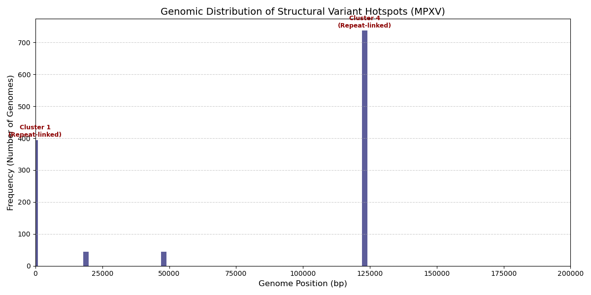

# MPXV Structural Variants & Ortholog Divergence (`mpxv-structural-variants-orthologs`)

> **Objective 3** of the B.Sc. (Life Sciences) 4th-Year Dissertation: *"Multi-Scale Genomic Architecture of Monkeypox Virus Human Adaptation: Mutation Hotspots, Structural Variants, and Ortholog Divergence in Sustained-Transmission Lineages"* (Department of Zoology, Deshbandhu College, University of Delhi, 2026).

## Overview

This repository documents the workflow, scripts, and outputs for detecting **structural variants (SVs)**, linking SV hotspots to repetitive sequences and functional/mobile domains, and evaluating clade-level variant patterns across Monkeypox virus (MPXV) genomes relative to the `NC_063383` reference.

## Pipeline & Scripts (`scripts/`)

1. **Alignment & SV Calling:**
   * **`scripts/step1_alignment.py`**: Aligns query MPXV genomes against `NC_063383.fasta` using `nucmer --maxmatch`, filters alignments with `delta-filter -q`, and calls structural differences via `show-diff` into `results/individual_svs/`.
2. **Aggregation, Clustering & Hotspot Extraction:**
   * **`scripts/step2_aggregate.py`**: Parses `.diff` calls into BED format, sorts coordinates (`sort -k1,1 -k2,2n`), clusters SVs within `200` bp using `bedtools cluster -d 200`, and exports hotspots occurring in `>= 12` genomes to `results/MPXV_SV_hotspots.tab`.
3. **Repeat, Motif & Domain Intersection:**
   * **`scripts/trf_to_bed.py`**: Converts Tandem Repeats Finder (`.dat`) output into `NC_063383_repeats.bed`.
   * **`scripts/step3_intersect.py`**: Intersects `results/MPXV_SV_hotspots.tab` with `NC_063383_repeats.bed` via `bedtools intersect` (`results/SVs_overlapping_repeats.tab`).
   * **`scripts/step3_final_link.py`**: Intersects `results/MPXV_SV_hotspots.tab` with `results/mobile_domains.bed` and extracts linked protein/domain products (`results/hotspots_vs_domains.tab`).
   * **`scripts/search_transposon_motifs.py`**: Starter script for scanning annotations/protein sequences for mobile-element signatures (`transposase`, `integrase`, `mobile element`, `insertion sequence`).
4. **Clade Integration & Visualization:**
   * **`scripts/prep_phylogeny_data.py`**: Joins `results/clustered_svs.bed` with `results/phylogeny/nextclade_assignments.tsv`, summarizes Cluster 4 prevalence by clade, and writes `results/phylogeny/final_tree_metadata.csv`.
   * **`scripts/plot_clade_sv.py`**: Computes Cluster 4 presence/absence across Nextclade assignments, exports `results/phylogeny/final_correlation_data.csv`, and plots `results/phylogeny/SV_Clade_Distribution.png`.
   * **`scripts/visualize_svs.py`**: Plots SV hotspot counts across genome coordinates (`0–200,000` bp), highlighting repeat-linked clusters (`1` and `4`) in `results/MPXV_SV_Distribution.png`.
   * **`scripts/plot_mpxv_circos.py`**: Generates a circular `pycirclize` map of genomic GAPs, breakpoints (BRK), and tandem repeats (`results/MPXV_Circos_Final_v2.png`).

## Visual Summary (`results/`)



MPXV Circular Structural Variant & Tandem Repeat Map: [`results/MPXV_Pangenome_Final.pdf`](results/MPXV_Pangenome_Final.pdf)

Additional R hotspot output: [`results/sv_hotspot.pdf`](results/sv_hotspot.pdf)

## Repository Structure

```text
mpxv-structural-variants-orthologs/
├── README.md
├── scripts/
│   ├── step1_alignment.py
│   ├── step2_aggregate.py
│   ├── trf_to_bed.py
│   ├── search_transposon_motifs.py
│   ├── step3_intersect.py
│   ├── step3_final_link.py
│   ├── prep_phylogeny_data.py
│   ├── plot_clade_sv.py
│   ├── visualize_svs.py
│   └── plot_mpxv_circos.py
└── results/
    ├── MPXV_SV_Distribution.png
    ├── MPXV_Circos_Final_v2.png
    ├── Rplot_sv_hotspot.pdf
    └── phylogeny/
        └── SV_Clade_Distribution.png
